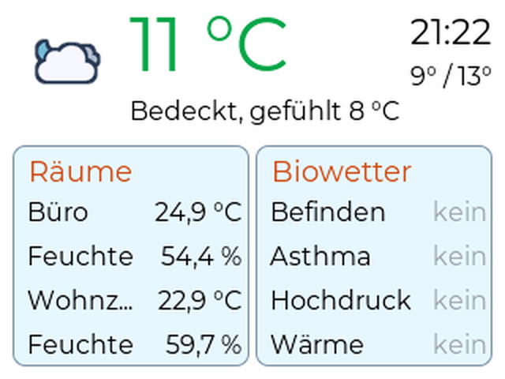
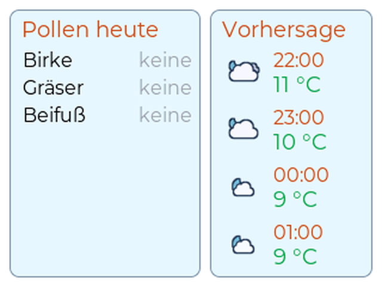
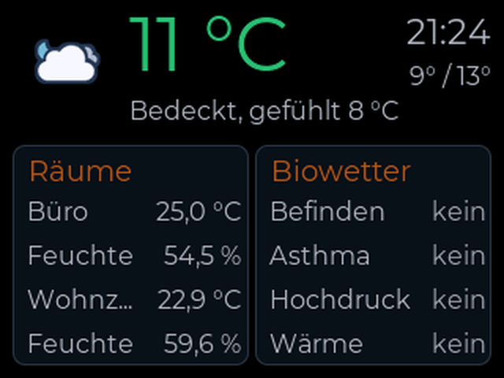

  <picture>
    <source media="(prefers-color-scheme: dark)" srcset="https://wettercube.de/wp-content/themes/wettercube/assets/images/wettercube-next-logo-hell.svg">
    
  </picture>

<strong>Das kleine Zusatzdisplay zur WetterCube Fusion: ein Display für jeden Raum</strong>

*[English version below](#english)*

**WetterCube Next** ist ein **zusätzliches Modul zur [WetterCube Fusion](https://github.com/JPPeterson-lab/WetterCube-Next)**: Ein kleiner **ESP32 CYD** („Cheap Yellow Display“, 2,8", 320×240, ESP32-2432S028) zeigt Daten der Fusion an. So bekommt jeder Raum seine eigene Anzeige, im Büro zum Beispiel Temperatur und Biowetter, im Schlafzimmer Allergene und Vorhersage. Der Next findet die Fusion im Heimnetz von selbst, braucht **keinen MQTT-Broker und keine Cloud** und läuft nur zusammen mit einer **Fusion ab v0.9.9-alpha6**. Er ist noch in einer frühen Alpha-Phase.

> **🔓 Open Source (Apache 2.0):** Quellcode, Web-Installer und Firmware liegen in diesem Repository. Texte und Bilder: CC BY-NC 4.0, Bestandteile Dritter: [CREDITS.md](CREDITS.md), Name und Logos sind nicht freigegeben ([NOTICE](NOTICE)).
>
> **⚠️ Nur das beschriebene CYD:** Die Software ist für das **ESP32 CYD ESP32-2432S028** (2,8", 320×240, ST7789) gedacht. CYD-Boards unterscheiden sich je nach Anbieter; andere Boards werden nicht unterstützt und können Probleme machen.
>
> **🛠️ Softwareprojekt:** Das Gerät baust du selbst (CYD kaufen, Firmware aufspielen, Gehäuse gestalten oder drucken), fertige Geräte gibt es nicht. Kurzanleitung: [Bauanleitung](https://wettercube.de/bauanleitung/).
>
> **⚖️ Auf eigene Gefahr:** Keine Haftung, siehe die [Nutzungshinweise](https://wettercube.de/nutzungshinweise/). Nicht für sicherheitskritische Zwecke einsetzen; nur mit geprüftem 5-V-USB-Netzteil betreiben. Fragen gern über das [Kontaktformular](https://wettercube.de/kontakt/) oder als [Issue](https://github.com/JPPeterson-lab/WetterCube-Next/issues).

## ✨ Das kann das Next

- **Seite 1, Temperatur und Biowetter:** Wettersymbol, Temperatur, Uhr, Tiefst- und Höchstwert, bis zu vier Sensorwerte aus dem Haus und die Biowetter-Kategorien deiner Fusion
- **Seite 2, Allergene und Vorhersage:** deine Allergene mit der Belastung heute und die Vorhersage
- **Antippen blättert weiter**, auf Wunsch automatisch; Nachtmodus mit Display aus, gedimmt oder als Nacht-Uhr
- **Einstellungen aller Next-Displays an einer Stelle** auf dem Fusion unter `http://wettercube-next.local` (ein Reiter je Next); Geräte-Einstellungen und Updates auf der eigenen Seite des Next (Updates auf Knopfdruck mit Rollback)

  
  
  

## 🚀 Installieren

1. CYD per USB anschließen und den **[Web-Installer](https://jppeterson-lab.github.io/WetterCube-Next/)** in Chrome oder Edge öffnen (das löscht den Flash, auch fremde Software auf dem CYD).
2. Mit dem WLAN **WetterCube-Next-Setup** verbinden (Passwort steht auf dem Display), das eigene WLAN eintragen, speichern.
3. Fertig: Das Next sucht die Fusion und zeigt die Daten. Weitere Einstellungen auf dem Fusion unter `http://wettercube-next.local` (Reiter dieses Next).

**Selbst bauen** mit ESP-IDF 5.5: `bash build.sh` (bauen), `bash build.sh flash /dev/cu.xxx` (flashen), beim ersten Mal auf einem CYD mit fremder Software `bash build.sh erstflash /dev/cu.xxx`. Einzelheiten im [Wiki](https://wiki.wettercube.de/index.php/Next/Entwicklung).

## 📖 Mehr erfahren

| Wo | Was |
|---|---|
| **[wettercube.de](https://wettercube.de/produkte/wettercube-next/)** | Überblick, [Vergleich der Cubes](https://wettercube.de/vergleich/), [Roadmap](https://wettercube.de/roadmap/), [Bauanleitung](https://wettercube.de/bauanleitung/) |
| **[Wiki](https://wiki.wettercube.de/index.php/Next/Start)** | Inbetriebnahme, Anbindung an die Fusion, Einstellungen, Updates, Fehlersuche, Entwicklung |
| **[Änderungsverlauf](CHANGELOG.md)** | was in welcher Version neu ist |

## 🙏 Credits und Lizenz

  <a href="https://picopixel.io/de/"><picture>
    <source media="(prefers-color-scheme: dark)" srcset="https://community.picopixel.io/branding/pico_dark_logo.png">
    
  </picture></a>

> 💙 **Danke an PicoPixel:** Die LVGL-UI des Next wird mit [PicoPixel](https://picopixel.io/de/) erstellt, einem kostenlosen, browserbasierten Drag-and-Drop-Editor für LVGL. Das ist kein Werbe- und kein Affiliate-Link, ich verdiene nichts daran.

Bibliotheken, Icons und Schriften von Dritten behalten ihre eigenen Lizenzen, Einzelheiten in [CREDITS.md](CREDITS.md). Die Daten stammen von der Fusion (Open-Meteo, CC BY 4.0, kostenlos nur für **nicht-kommerzielle Nutzung**; [DWD Opendata](https://opendata.dwd.de), CC BY 4.0, „Quelle: Deutscher Wetterdienst“).

| Was | Lizenz | Datei |
|---|---|---|
| **Quellcode, Firmware, Werkzeuge** | Apache 2.0 | [LICENSE](LICENSE), [NOTICE](NOTICE) |
| **Texte, Bilder, Dokumentation** | CC BY-NC 4.0 | [LICENSE-Dokumentation.txt](LICENSE-Dokumentation.txt) |
| **Bestandteile Dritter** | eigene Lizenzen | [CREDITS.md](CREDITS.md) |

Du darfst den Quellcode nutzen, verändern und weitergeben, auch kommerziell; die Software wird ohne Gewähr bereitgestellt (Abschnitte 7 und 8 der Lizenz).

> **Versprechen:** Die private Nutzung von WetterCubePlus, Fusion und Next bleibt auch in Zukunft frei.

**Mitmachen:** Pull Requests sind willkommen und werden unter der Apache-Lizenz 2.0 aufgenommen (Abschnitt 5). Fehler und Wünsche gern als [Issue](https://github.com/JPPeterson-lab/WetterCube-Next/issues).

---

# WetterCube Next (English)

**WetterCube Next** is an **additional module for the [WetterCube Fusion](https://github.com/JPPeterson-lab/WetterCube-Next)**: a small **ESP32 CYD** ("Cheap Yellow Display", 2.8", 320×240, ESP32-2432S028) shows data from the Fusion, so every room gets its own display, for example temperature and Biowetter in the office, allergens and forecast in the bedroom. Next finds the Fusion on your home network by itself, needs **no MQTT broker and no cloud**, and only runs together with a **Fusion from v0.9.9-alpha6**. It is still in an early alpha phase.

> **🔓 Open source (Apache 2.0):** source code, web installer and firmware are in this repository. Texts and images: CC BY-NC 4.0, third-party components: [CREDITS.md](CREDITS.md), name and logos are not licensed ([NOTICE](NOTICE)).
>
> **⚠️ Only the described CYD:** The software is meant for the **ESP32 CYD ESP32-2432S028** (2.8", 320×240, ST7789). CYD boards differ depending on the vendor; other boards are not supported and can cause problems.
>
> **🛠️ Software project:** You build the device yourself (buy a CYD, flash the firmware, design or print a case); there are no finished devices. Short guide: [build guide](https://wettercube.de/en/build-guide/).
>
> **⚖️ At your own risk:** No liability, see the [usage notes](https://wettercube.de/en/usage-notes/). Do not use for safety-critical purposes; only run it with a tested 5 V USB power supply. Questions are welcome through the [contact form](https://wettercube.de/en/contact/) or as an [issue](https://github.com/JPPeterson-lab/WetterCube-Next/issues).

## ✨ What Next can do

- **Page 1, temperature and Biowetter:** weather icon, temperature, clock, min/max, up to four sensor values from the house and the Biowetter categories of your Fusion
- **Page 2, allergens and forecast:** your allergens with today's level and the forecast
- **Tapping turns the page**, optionally automatically; night mode with the display off or dimmed
- **Settings of all Next displays in one place** on the Fusion at `http://wettercube-next.local` (one tab per Next); device settings and updates on the Next's own page (updates on a button press with rollback)

  
  
  

## 🚀 Installation

1. Connect the CYD via USB and open the **[web installer](https://jppeterson-lab.github.io/WetterCube-Next/)** in Chrome or Edge (this erases the flash, including any foreign software on the CYD).
2. Connect to the Wi-Fi **WetterCube-Next-Setup** (password shown on the display), enter your own Wi-Fi, save.
3. Done: Next looks for the Fusion and shows the data. More settings on the Fusion at `http://wettercube-next.local` (tab of this Next).

**Build it yourself** with ESP-IDF 5.5: `bash build.sh` (build), `bash build.sh flash /dev/cu.xxx` (flash), the first time on a CYD with foreign software `bash build.sh erstflash /dev/cu.xxx`. Details in the [wiki](https://wiki.wettercube.de/index.php/Next/Entwicklung).

## 📖 Learn more

| Where | What |
|---|---|
| **[wettercube.de](https://wettercube.de/en/products/wettercube-next/)** | overview, [comparison of the cubes](https://wettercube.de/en/comparison/), [roadmap](https://wettercube.de/en/roadmap/), [build guide](https://wettercube.de/en/build-guide/) |
| **[Wiki](https://wiki.wettercube.de/index.php/Next/Start)** | getting started, connection to the Fusion, settings, updates, troubleshooting, development |
| **[Changelog](CHANGELOG.en.md)** | what is new in which version |

## 🙏 Credits and licence

  <a href="https://picopixel.io/"><picture>
    <source media="(prefers-color-scheme: dark)" srcset="https://community.picopixel.io/branding/pico_dark_logo.png">
    
  </picture></a>

> 💙 **Thanks to PicoPixel:** The LVGL UI of the Next is created with [PicoPixel](https://picopixel.io/), a free, browser-based drag-and-drop editor for LVGL. This is not an advertisement or affiliate link, I earn nothing from it.

Libraries, icons and fonts by third parties keep their own licences, details in [CREDITS.md](CREDITS.md). The data comes from the Fusion (Open-Meteo, CC BY 4.0, free for **non-commercial use only**; [DWD Opendata](https://opendata.dwd.de), CC BY 4.0, “Quelle: Deutscher Wetterdienst”).

| What | Licence | File |
|---|---|---|
| **Source code, firmware, tools** | Apache 2.0 | [LICENSE](LICENSE), [NOTICE](NOTICE) |
| **Texts, images, documentation** | CC BY-NC 4.0 | [LICENSE-Dokumentation.txt](LICENSE-Dokumentation.txt) |
| **Third-party components** | their own licences | [CREDITS.md](CREDITS.md) |

You may use, modify and share the source code, also commercially; the software is provided without warranty (sections 7 and 8 of the licence).

> **Promise:** Private use of WetterCubePlus, Fusion and Next stays free in the future.

**Contributing:** Pull requests are welcome and are accepted under the Apache License 2.0 (section 5). Bugs and wishes as an [issue](https://github.com/JPPeterson-lab/WetterCube-Next/issues).
